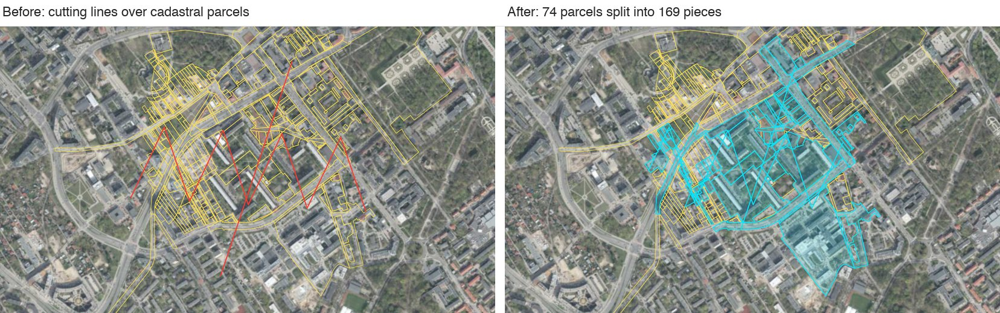
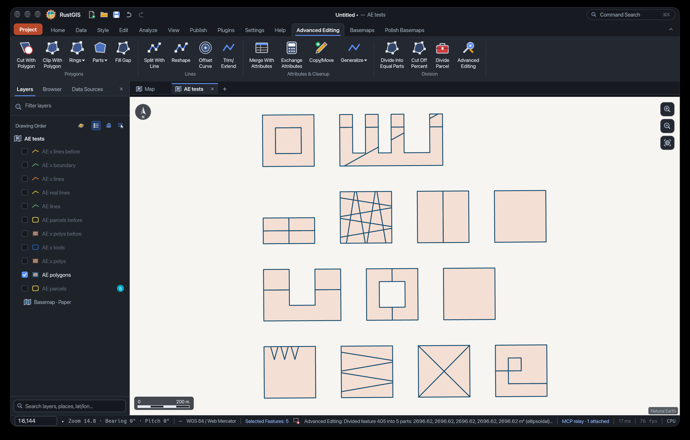
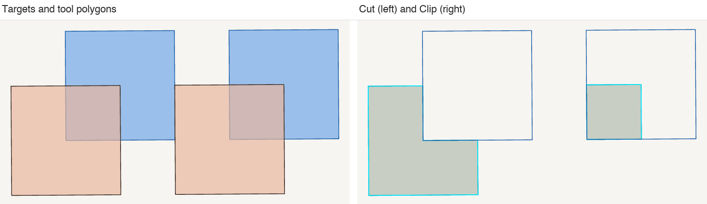

# Advanced Editing

Advanced vector editing for [RustGIS](https://github.com/opengeos/rustgis-plugins): the counterpart of QGIS's Advanced Digitizing toolbar, the Digitizing Tools plugin and the parcel division plugins. It cuts, clips and splits with polygons and lines, adds, deletes and fills rings, adds, deletes and splits off parts, fills gaps, reshapes, offsets, trims and extends, merges and exchanges attributes, copies and moves, simplifies, densifies and smooths, and divides parcels by area. It runs as a sandboxed WebAssembly module with only the `edit` permission, and every command is exactly one undo step.



*Split With Line on adjacent real cadastral parcels: every parcel the lines cross is split, and the boundaries between neighbours stay identical.*

- **Selection-driven.** Draw or pick features with RustGIS's own tools, select them, click a command. No dialogs.
- **Shared boundaries stay intact.** Vertices a command does not move keep their exact original coordinates, new vertices lie exactly on the original edges, and topological editing adds them to the neighbours that share the edge.
- **Cadastral-grade division.** Parcels are divided by true ellipsoidal (GRS80) area, accurate to 0.01 m² or 1 ppm.
- **Safe.** A command that cannot do what it was asked changes nothing and says what to select instead.

## Contents

- [Interface](#interface)
- [Features](#features)
- [How it works](#how-it-works)
- [Parcel division](#parcel-division)
- [Quality and testing](#quality-and-testing)
- [Limits](#limits)
- [Permissions](#permissions)
- [Installation](#installation)
- [Scripts and the command line](#scripts-and-the-command-line)
- [Building from source](#building-from-source)
- [Running the tests](#running-the-tests)
- [Project layout](#project-layout)
- [License and credits](#license-and-credits)

The full reference of every command is in [docs/COMMANDS.md](docs/COMMANDS.md); what is tested and how is in [docs/TESTING.md](docs/TESTING.md).

## Interface



*The **Advanced Editing** tab in RustGIS. The status bar shows the result of Divide Into Equal Parts; the **Advanced Editing** button at the end of the tab opens the settings panel.*

The plugin adds one ribbon tab, **Advanced Editing**, at the end of the tab strip, a settings panel of the same name, and the **Divide Parcel** tool in the Tools pane (toolbox *Advanced Editing*).

## Features


*The ribbon tab, left to right: Polygons, Lines, Attributes & Cleanup, Division.*

Terms used throughout: **tool features** are the selected features of the **active layer** (the cutter, the splitting line, the boundary); **target features** are the features the command edits (see [Selection model](#selection-model)); the **panel** is the Advanced Editing settings panel.

### Polygons

| Command | What it does |
|---|---|
| Cut With Polygon | Removes the tool polygons' area from the target polygons; a target left empty is deleted. |
| Clip With Polygon | Keeps only the part of the target polygons inside the tool polygons. |
| Rings ▾ Add Ring | Punches each tool polygon as a hole into the target polygon around it. |
| Rings ▾ Delete Ring | Removes the holes of the selected polygons (or only those the locators touch). |
| Rings ▾ Fill Ring | Fills holes with new polygons that copy the attributes of the polygon around them; islands in the hole stay out. |
| Parts ▾ Add Part | Adds the tool polygons as new parts of one target polygon. |
| Parts ▾ Delete Part | Deletes every part but the largest (or the parts the locators touch); never the last part. |
| Parts ▾ Split Off Part | Moves every part but the largest (or the parts the locators touch) into new features with the same attributes. |
| Fill Gap | Adds each gap enclosed by the selected polygons as a new polygon. |


*Fill Ring with an island: the new polygon covers 100² − 40² = 8 400 m² and does not overlap the island.*



*Cut With Polygon (left) and Clip With Polygon (right), each tool overlapping a quarter of its 100 m × 100 m target: 7 500 m² remain after the cut, 2 500 m² after the clip.*


*Fill Gap: the enclosed gap becomes a new 20 000 m² polygon; gaps open to the outside are left alone.*

### Lines

| Command | What it does |
|---|---|
| Split With Line | Splits target polygons or lines where a tool line crosses them from side to side; a closed line inside a polygon cuts out the area it encloses. The largest piece keeps the feature. |
| Reshape | Replaces the stretch of the target's outline between the first and last crossing with the tool line; a line that would cut a polygon in two is refused. |
| Offset Curve | Offsets lines sideways, or polygons outwards or inwards, by Distance, as a copy or in place. |
| Trim/Extend | Trims target lines back to a boundary line or polygon, or extends them to it however far it is. |


*Split With Line on 13 difficult cases: a sawtooth entering and leaving 6 times, a zigzag, two crossing lines, a self-crossing loop, a U-shape, a polygon with a hole, an adjacent pair, two crossing zigzags (25 pieces), a line through a vertex and along an edge, a comb, and a closed ring cutting out an island. Tangent and dangling lines do not split.*


*Reshape. Left: refused, because the line would cut the polygon in two (that is Split With Line's job). Right: the outline follows the line, adding a bump (11 800 m²).*


*Offset Curve, 10 m to the right of a zigzag: corners on the offset side are rounded, the others trimmed, and no point of the offset comes nearer to the line than the distance (less up to 0.13 % for the chords of round corners).*


*Trim/Extend: the upper line is trimmed back to the boundary, the lower one extended along its last segment; both end exactly on it.*

### Attributes & Cleanup

| Command | What it does |
|---|---|
| Merge With Attributes | Merges the selected features into the largest one, which keeps its id and attributes; optionally sums numeric fields. Overlapping lines are dissolved, so a shared stretch counts once. |
| Exchange Attributes | Swaps all field values of two selected features. |
| Copy/Move | Copies or moves the selected features by Distance towards Bearing. |
| Generalize ▾ Simplify | Removes vertices closer than Tolerance to the simplified shape. |
| Generalize ▾ Densify | Adds vertices so that no segment is longer than Distance. |
| Generalize ▾ Smooth | Cuts the corners Smoothing iterations times; line ends stay. |

Simplify and Smooth edit each feature on its own: a boundary shared with a neighbour can open a gap or an overlap, and the message says so.

### Division

| Command | What it does |
|---|---|
| Divide Into Equal Parts | Divides each selected polygon into Parts parts of equal ellipsoidal area with parallel cuts. |
| Cut Off Percent | Cuts Cut-off share percent of the ellipsoidal area off each selected polygon as a new feature. |
| Divide Parcel (tool) | Proposes a division into equal parts, parts of a given area or strips of a given width as a new layer; the parcels are not changed. |
| Advanced Editing | Opens the settings panel. |


*Divide Into Equal Parts on a real parcel with holes: 13 483.12 m² into 5 × 2 696.62 m² at a grid bearing of 30°.*


*Cut Off Percent on an L-shaped parcel: 30 % cut off from the east with north–south cuts (0°, Divide from the other side).*

## How it works

### Selection model

RustGIS plugins cannot take map clicks, so there are no click-to-draw tools as in QGIS. The selection says what to work on:

- **Tool features** are the selected features of the **active layer**: the cutting polygon, the splitting or reshaping line, the boundary to trim to, the polygon to add as a ring or part.
- **Target features** are the selected features of the **other layers**. When no other layer has a selection, the targets are the features of the active layer that touch the tool features (the tools themselves excluded). With **Use whole active layer as targets** on, the targets always come from the active layer.
- **Commands without a tool** (Delete Ring, Fill Ring, Fill Gap, Delete Part, Split Off Part, Merge, Exchange, Copy/Move, Generalize, the division commands) edit the selected features of the active layer.
- **Locators.** Delete Ring, Fill Ring, Delete Part and Split Off Part also look at the features selected in other layers: they limit the command to the holes or parts those features touch.

After a command, the changed and new features are selected. When the selection does not fit, the command changes nothing and says what to select, for example: *Select one reshaping line in the active layer and the polygons or lines to reshape in another layer. (2 line feature(s) selected in the active layer 'tools')*.

### Panel values and script parameters

The panel holds the settings the commands use: Distance, Tolerance, Smoothing iterations, Parts, Cut-off share, Division direction, Bearing and seven checkboxes. A ribbon click uses the panel values. A script or `rustgis-cli` call can pass any of them as a command parameter, which overrides the panel for that call only. The full table, with units, ranges and defaults, is in [docs/COMMANDS.md](docs/COMMANDS.md#panel-and-parameters).

### Undo and rollback

Each command is one undo step, however many features it changed, added or deleted (including the vertices that topological editing adds to neighbours). A command that fails returns an error and RustGIS rolls back all of its edits; commands also check their input and their budget before the first edit, so a refusal normally means nothing was touched. The Divide Parcel tool adds one new layer and edits nothing.

### Metric frame

RustGIS hands features to plugins in longitude/latitude and does not tell them the layer's CRS, so every command projects its input to a metric frame, works in metres and projects back:

- **EPSG:2180** (PUWG 1992, the storage CRS of Polish cadastral data) when every input position lies within 14.0–24.2°E, 49.0–54.9°N;
- otherwise the **WGS 84 UTM zone** of the centre of the input's extent.

The transverse Mercator projection is implemented in the plugin itself: the Krüger series to n⁶ (Karney 2011, the method of PROJ's `tmerc`), summed with Clenshaw's method. It agrees with a 45-digit evaluation of the same series to within 3 nm. Input spanning more than 20° of longitude, or reaching beyond ±84° latitude, is refused.

### Shared boundaries

Cut With Polygon, Clip With Polygon, Split With Line and the division commands keep the boundaries between neighbouring features identical, so the layer gains no gaps or overlaps:

| Mechanism | Tolerance | What it does |
|---|---|---|
| Bit-exact untouched vertices | 0.01 mm (1e-5 m) | Every result vertex within 0.01 mm of an input vertex is replaced by that vertex's original longitude/latitude, so the projection round trip and the boolean operations' integer grid do not move it. All commands that write geometry do this. |
| Tool snapping | 1 mm (1e-3 m) | A tool vertex within 1 mm of a target vertex moves onto it, else within 1 mm of a target edge onto the edge; a target vertex within 1 mm of a tool segment becomes a tool vertex. A line drawn along a parcel boundary then runs exactly along it and splits nothing there. Stretches of a splitting line along a target's edges are dropped, and its ends on the boundary count as crossing it. |
| New vertices on original edges | 0.01 mm (1e-5 m) | A result vertex within 0.01 mm of an edited feature's edge (and not at one of its vertices) is placed exactly on that edge, at the edge's crossing with the tool computed from their end points in a fixed order. Every piece that shares the vertex, also of another feature cut in the same command, gets bit-identical coordinates; it lies on the edge to about 1e-9 m. |
| Topological editing | on the edge's line within 1 mm, through the vertex within 0.01 mm | Each such vertex is also inserted into the features that are **not** edited and share the edge. It looks in the edited layers (visible or not), then in the other visible layers of the same geometry type, never in the tools. On by default (panel checkbox, `topological` in scripts). |
| Sliver threshold | 1 cm² (1e-4 m²) | Pieces of Cut, Clip and Split With Line smaller than this are dropped as precision noise. Fill Gap ignores gaps under 0.01 m² or narrower than 1 cm. |

Topological editing uses RustGIS's own vertex editing, which moves nothing else, and is part of the command's undo step. The message counts it: *Split 2 feature(s) into 4 pieces; added 2 shared vertices to 2 neighbouring feature(s)*. RustGIS cannot read features by area, so each searched layer is read whole; a layer too large to read within the command's budget is skipped and named in the message.

Edges are straight in the working frame. A cadastral edge stored in EPSG:2180 is therefore cut exactly where it lies; in a geographic view a 100 m edge drawn straight in longitude/latitude bends by about 0.2 mm in the frame, which tool snapping absorbs.

## Parcel division

Three ways to divide:

| | Input | Output |
|---|---|---|
| **Divide Into Equal Parts** (command) | Selected polygons of the active layer; Parts (panel 2–50, scripts 2–1000), Division direction, Divide from the other side | The first part keeps the feature; the others become new features with its attributes (without `id`, `fid`, `ogc_fid`). |
| **Cut Off Percent** (command) | Selected polygons; Cut-off share (panel 1–99 %, scripts any value greater than 0 and less than 100), direction, side | The cut-off share becomes a new feature; the rest keeps the feature. |
| **Divide Parcel** (tool) | A polygon layer (its selection, if any); *Equal parts* (Count 2–10 000), *Parts of given area* (Area in m², the remainder last), *Strips of given width* (Width in m, the remainder last); Direction; Ellipsoidal or Planar area; Start from the other side | A new layer *&lt;input&gt; divided*: each part with the source's attributes plus `src_id`, `part` (1, 2, … along the sweep) and `area_m2`. The parcels are not changed. |

**Cut lines.** All cuts are parallel straight lines. Each cut position is found by root finding on the exact area on one side of the line; positions are cumulative (the k-th cut leaves k/n of the area behind it), so errors do not add up along the sweep. All lines then cut the parcel in one pass, so neighbouring parts share bit-identical vertices on their common cut. A cut through a concave or multi-part parcel can give a part of several pieces, which stays one MultiPolygon feature. New vertices on the parcel's edges are placed exactly on them and, with topological editing, added to the neighbours.

**Direction.** The direction is a **grid bearing** of the working frame (EPSG:2180, or UTM outside Poland), clockwise: 0° gives north–south lines, 90° east–west lines. It differs from geographic north by the meridian convergence, up to about 4° at the edges of Poland.

**Numbering.** Parts are numbered from the left of the line direction: from the west with 0°, from the north with 90°. **Divide from the other side** (`reverse`) starts from the east or south; Cut Off Percent then cuts its share off that side.

**Ellipsoidal and planar area.** Areas are ellipsoidal by default: the true area on the GRS80 ellipsoid, which is what a cadastral area means. The projection is conformal, so an area element on the ellipsoid is its frame area divided by k², the squared point scale factor; the plugin integrates 1/k², linearised over the parcel, exactly. Planar area (tool only) is measured in the EPSG:2180 or UTM plane. EPSG:2180 planar area differs from the ellipsoidal one by about −0.14 % on the central meridian (19°E) and up to about +0.15 % at the eastern and western edges of Poland. The test parcel near 23.2°E measures 13 489.86 m² planar against 13 483.12 m² ellipsoidal (+0.05 %).

**Accuracy.** Each part's area is accurate to 0.01 m² or 1 ppm of the part, whichever is larger. The message reports the largest deviation, for example *Divided 3 polygons into 4 equal parts each (ellipsoidal area, largest error 0.0000 m²)*.

```sh
rustgis-cli run --plugin advanced-editing-0.1.0.rgplugin --data parcels.gpkg \
  --cmd 'gp.run={"tool":"plugin:advanced-editing/divide-parcel","params":{"input":"parcels","mode":"Parts of given area","area":1500,"angle":90,"areaMode":"Ellipsoidal"}}'
```

## Quality and testing

The plugin is tested end to end: 201 tests drive the real WebAssembly module in a headless RustGIS and check the results against independent geometry, not against the plugin's own output.

| Check | Result |
|---|---|
| Split With Line vs. planar-graph oracle (shapely `polygonize`) | piece counts and areas match; pieces cover the original within max(1e-4 m², 1e-6·A), no overlaps |
| Untouched vertices | bit-exact (within one ulp of the host's coordinate rounding) |
| New vertices on original edges | within 1.9e-9 m of the edge |
| Projection vs. 45-digit reference | within 3e-9 m; vs. PROJ (pyproj) within 2.4e-9 m |
| Division areas vs. independent ellipsoidal area | within max(0.01 m², 1e-6·A) |
| Undo | restores every feature in one step; refused commands change nothing |
| Real data (76 adjacent cadastral parcels, zigzag + crossing line) | 74 parcels split into 169 pieces, each matching the oracle; untouched parcels move ≤ 3.3e-9 m |

The commands were also verified in the RustGIS desktop app on the installed build, with the exports checked independently in shapely and pyproj. Details, the oracles and an inventory of every test file are in [docs/TESTING.md](docs/TESTING.md).

## Limits

RustGIS stops a plugin command that computes for too long, so every command first estimates what it was asked to do and, when that would not fit, changes nothing and says what to select instead. The figures below are approximate:

- A command edits about 20 000 vertices (fewer with many small features) and reads about 1.2 MB of features, roughly 30 000 vertices. Larger layers need a selection.
- Densify, Smooth and Offset Curve write at most about 40 000 vertices they create.
- Divide Into Equal Parts and Cut Off Percent check the division itself before cutting: for example about 200 parcels of 20 vertices into 4 parts, or one parcel of about 9000 vertices into 2 parts. Beyond that they ask for fewer polygons or the Divide Parcel tool.
- Offset Curve's own work grows with how often a line comes back within the distance of itself, and for polygons faster than their vertex count: offsetting a smooth line of about 3000 vertices by 20 m takes about a third of a command, a dense zigzag much more. The jitter of densely digitised lines (GPS tracks) is left out of the work where that moves the offset by less than 0.004 % of the distance, so they can be offset by far more than their vertex spacing.
- The Divide Parcel tool runs in the background with 60 times a command's budget and edits nothing (it adds a layer); it checks its division the same way.
- Topological editing reads each layer it searches whole, within what is left of the command's read budget; a layer that does not fit is skipped and named in the message.
- Coordinates come in longitude/latitude; very large features (over 20° of longitude) and the polar regions (beyond ±84°) are refused.

## Permissions

`edit`: changing features and adding the division layer. The plugin has no file or network access.

## Installation

Requires RustGIS 0.4.0 or later.

- **From the plugin registry** (once published): **Plugins › Manage › Browse Plugins**, find **Advanced Editing**, install.
- **From a package file**: download `advanced-editing-<version>.rgplugin` from the [GitHub releases](https://github.com/PawelKra/advanced-editing/releases), then **Plugins › Manage › Install Plugin** and choose the file (or drop it on the RustGIS window).
- **From the command line**:

```sh
rustgis-cli plugins install advanced-editing-0.1.0.rgplugin
rustgis-cli run --plugin advanced-editing-0.1.0.rgplugin --data parcels.gpkg --cmd '…'   # load for one run only
```

## Scripts and the command line

Every command is `plugin:advanced-editing/<command-id>`; set the active layer and the selection first, then run it with optional parameters:

```sh
rustgis-cli run --plugin advanced-editing-0.1.0.rgplugin --data parcels.gpkg \
  --cmd 'layer.select={"layer":"parcels"}' \
  --cmd 'select.rows={"layer":"parcels","rows":[4]}' \
  --cmd 'plugin:advanced-editing/divide-equal={"parts":3,"angle":90}' \
  --cmd 'data.convert={"layer":"parcels","format":"geojson","path":"out.geojson"}'
```

Parameters: `distance` and `tolerance` in metres, `iterations`, `parts`, `percent`, `angle`, `bearing`, `keepTools`, `left`, `move`, `sum`, `reverse`, `wholeLayer`, `topological`. `parts` must be a whole number from 2 to 1000 and `percent` greater than 0 and less than 100 (fractions allowed); other values are refused, not clamped. See [docs/COMMANDS.md](docs/COMMANDS.md) for each command's parameters and examples.

## Building from source

Requirements: Rust 1.90 or later with the `wasm32-unknown-unknown` target, and `zip`.

```sh
rustup target add wasm32-unknown-unknown   # once
cargo fetch                                # once: build.sh builds offline
./build.sh
```

`build.sh` builds the WebAssembly module (`cargo build --offline --release --target wasm32-unknown-unknown`) and packs `advanced-editing-<version>.rgplugin` (`plugin.json` + `plugin.wasm`, staged in `pkg/`). It also builds `pkg-diag/plugin.wasm`, the same module with the diagnostic commands the tests use; that build never ships.

| Variable | Meaning |
|---|---|
| `CARGO_TARGET_DIR` | The build directory (default `target/`). |
| `AE_CONDA_ENV` | Optional: run cargo inside this conda environment (`conda run -n …`); default: cargo from `PATH`. |

The crate builds only for `wasm32-unknown-unknown` (set in `.cargo/config.toml`); there are no native unit tests. Dependencies: `rustgis-plugin`, `geo`, `i_overlay`, `serde_json`.

## Running the tests

```sh
./build.sh
python -I tests/run.py                              # every tests/test_*.py
python -I tests/run.py polygons                     # tests/test_polygons.py only
python -I tests/run.py -k split                     # tests whose name contains "split"
AE_REAL_DATA=parcels.gpkg python -I tests/run.py    # also the tests on real parcels
```

The harness itself uses only the Python standard library and needs `rustgis-cli` on `PATH` (or `RUSTGIS_CLI`). Further environment:

| Variable | Meaning |
|---|---|
| `AE_REAL_DATA` | A file of adjacent parcels in Poland (e.g. a GeoPackage) for the 14 real-data tests; skipped when unset. Real data is never stored in the repository. |
| `AE_SHAPELY_PYTHON` | A Python interpreter with shapely, used over a pipe by the geometry-oracle tests. When unset, the running Python is used if it has shapely; otherwise those tests are skipped. |
| `RUSTGIS_CLI` | The `rustgis-cli` to use (default: the one on `PATH`). |
| `AE_TMP`, `AE_KEEP_TMP` | Where the temporary directory goes; `AE_KEEP_TMP=1` keeps it. |

See [docs/TESTING.md](docs/TESTING.md) for what the tests check and [tests/README.md](tests/README.md) for writing new ones.

## Project layout

| Path | Contents |
|---|---|
| `plugin.json` | Manifest: commands and their help, the ribbon tab, the panel, the Divide Parcel tool. |
| `src/lib.rs` | Command dispatch, panel settings (`Settings`), `Ctx`. |
| `src/selection.rs` | Tool and target features from the selection. |
| `src/host_io.rs` | Typed host requests (layers, features, edits, selection, messages) and the budget guards. |
| `src/geojson.rs` | GeoJSON ↔ `geo` geometries, normalisation and output checks. |
| `src/proj.rs` | EPSG:2180 and UTM transverse Mercator, metric frames, bit-exact vertex snapping. |
| `src/topo.rs` | Shared boundaries: tool snapping, new vertices on original edges, topological editing. |
| `src/polygons.rs`, `src/lines.rs`, `src/attributes.rs`, `src/division.rs` | The commands. |
| `src/diagnostics.rs` | Diagnostic commands for the tests (feature `diagnostics`, never shipped). |
| `tests/` | The test harness (`run.py`, `aelib.py`) and the test files. |
| `docs/` | [COMMANDS.md](docs/COMMANDS.md), [TESTING.md](docs/TESTING.md), images. |
| `build.sh` | Builds the package and the diagnostic module. |

## License and credits

MIT, see [LICENSE](LICENSE). © 2026 Pawel Krapiec.

Orthophoto: © GUGiK (geoportal.gov.pl). Cadastral parcels in the screenshots and real-data tests: public Polish cadastral data (EGiB), part of Białystok.
