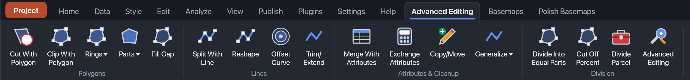
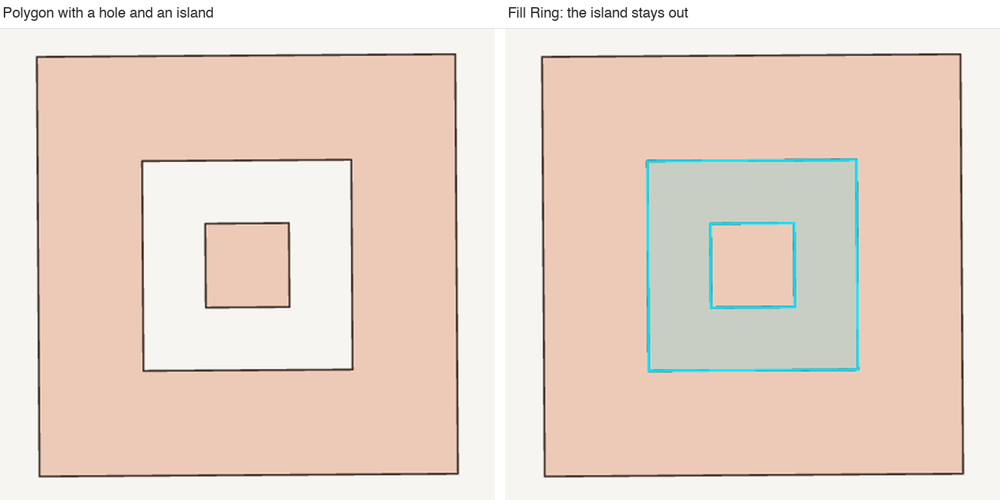
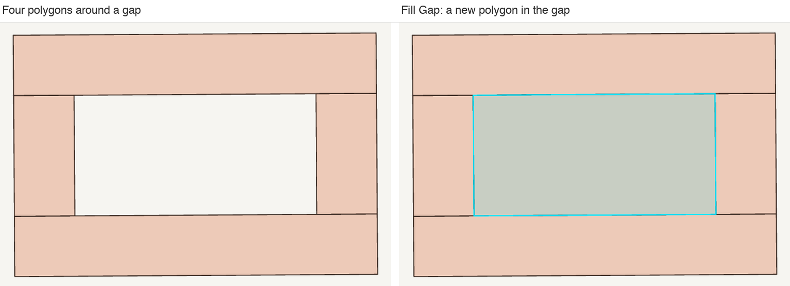
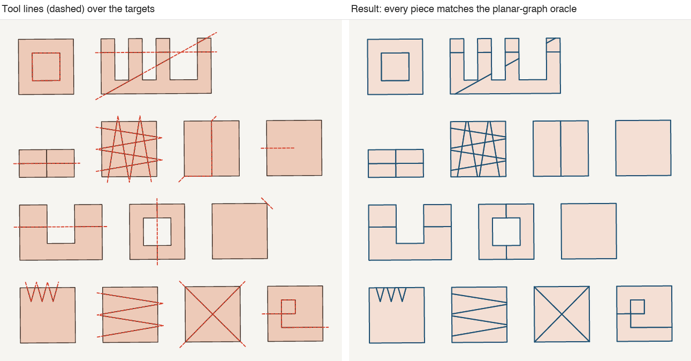
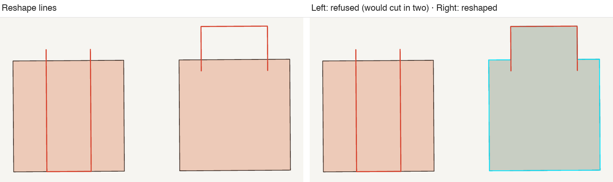
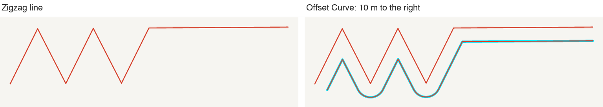
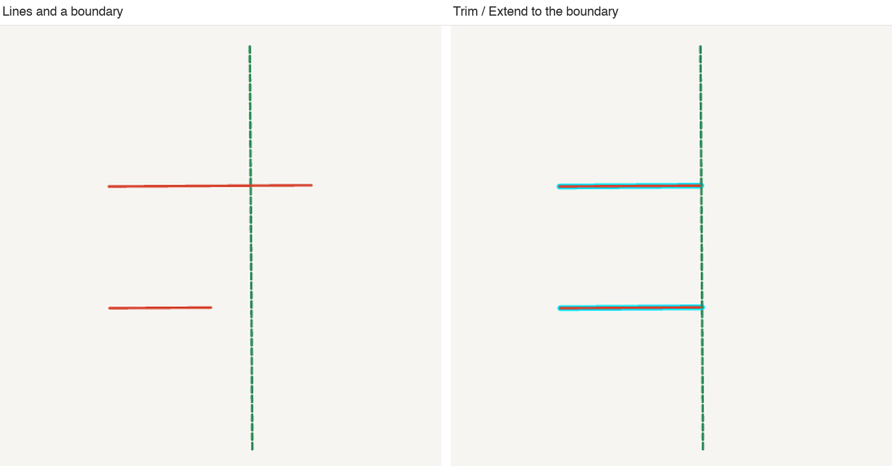
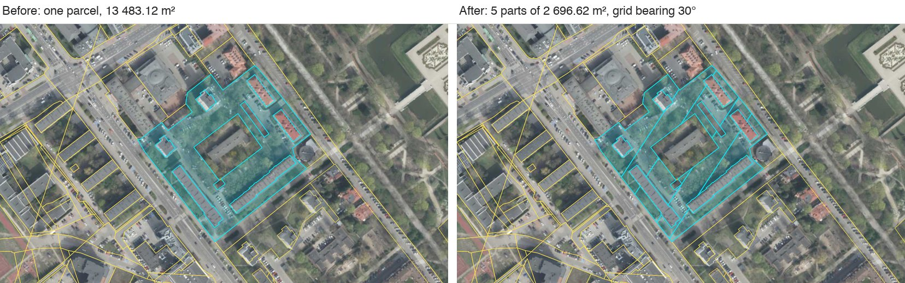
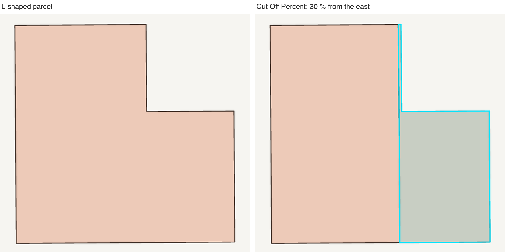

# Command reference

Every command of the **Advanced Editing** ribbon tab and the **Divide Parcel** tool: what it reads, what it writes, its settings, and when it refuses.



*The ribbon tab, left to right: Polygons, Lines, Attributes & Cleanup, Division.*

## Contents

- [Conventions](#conventions)
- [Panel and parameters](#panel-and-parameters)
- [Messages and refusals common to all commands](#messages-and-refusals-common-to-all-commands)
- Polygons: [Cut With Polygon](#cut-with-polygon) · [Clip With Polygon](#clip-with-polygon) · [Add Ring](#add-ring) · [Delete Ring](#delete-ring) · [Fill Ring](#fill-ring) · [Add Part](#add-part) · [Delete Part](#delete-part) · [Split Off Part](#split-off-part) · [Fill Gap](#fill-gap)
- Lines: [Split With Line](#split-with-line) · [Reshape](#reshape) · [Offset Curve](#offset-curve) · [Trim/Extend](#trimextend)
- Attributes & Cleanup: [Merge With Attributes](#merge-with-attributes) · [Exchange Attributes](#exchange-attributes) · [Copy/Move](#copymove) · [Simplify](#simplify) · [Densify](#densify) · [Smooth](#smooth)
- Division: [Divide Into Equal Parts](#divide-into-equal-parts) · [Cut Off Percent](#cut-off-percent) · [Divide Parcel (tool)](#divide-parcel-tool) · [Refresh Panel](#refresh-panel)

## Conventions

- **Active layer**: the layer selected in the Layers pane.
- **Tool features**: the selected features of the active layer (a cutter, a splitting line, a boundary).
- **Target features**: the features a tool command edits. They are the selected features of the **other** vector layers; when no other layer has a selection, or with **Use whole active layer as targets** (`wholeLayer`), they are the features of the active layer that intersect a tool feature, the tools themselves excluded.
- **Locators**: for Delete Ring, Fill Ring, Delete Part and Split Off Part, the features selected in other vector layers (points, lines or polygons). They limit the command to the holes or parts they intersect; without locators the command acts on all of them.
- **Working frame**: all geometry work happens in metres, in EPSG:2180 when every input position lies in Poland (14.0–24.2°E, 49.0–54.9°N), otherwise in the WGS 84 UTM zone of the centre of the input's extent. Distances, areas and bearings below are in this frame unless stated otherwise ("ellipsoidal" areas are on GRS80).
- **Bit-exact vertices**: every vertex a command writes back within 0.01 mm of an input vertex gets that vertex's original coordinates. This holds for every command below and is not repeated.
- **Result selection**: after a successful command, the changed and new features are selected.
- **Undo**: each command is one undo step; a refused or failed command changes nothing.
- **Command id**: scripts call `plugin:advanced-editing/<id>`.

The `rustgis-cli` examples assume the plugin package in the current directory and data files whose layer names are their file names, e.g. `parcels.gpkg` → layer `parcels`. `layer.select` makes a layer active, `select.rows` selects rows (`"mode":"add"` keeps the existing selection, also in other layers).

## Panel and parameters

The **Advanced Editing** panel (the last button of the tab) holds the settings. A ribbon click uses the panel values; a script parameter overrides the panel value for that call only.

| Panel setting | Parameter | Unit and range | Default | Used by |
|---|---|---|---|---|
| Distance | `distance` | metres; panel steps 0.01, 0.02, 0.05, 0.1, 0.2, 0.25, 0.5, 1, 2, 2.5, 5, 10, 15, 20, 25, 30, 40, 50, 75, 100, 150, 200, 250, 500, 1000; script any value > 0 | 1 m | Offset Curve (offset), Copy/Move (shift), Densify (longest segment), Trim/Extend (search radius) |
| Tolerance | `tolerance` | metres; panel steps 0.001, 0.002, 0.005, 0.01, 0.02, 0.05, 0.1, 0.2, 0.25, 0.5, 1, 2, 5, 10, 20, 50; script any value > 0 | 0.1 m | Simplify |
| Smoothing iterations | `iterations` | panel 1–5; script rounded and clamped to 1–10 | 2 | Smooth |
| Parts | `parts` | panel 2–50; script a whole number 2–1000, else refused | 2 | Divide Into Equal Parts |
| Cut-off share (%) | `percent` | panel 1–99; script > 0 and < 100, fractions allowed, else refused | 50 | Cut Off Percent |
| Division direction (°) | `angle` | grid bearing of the cut lines, clockwise; panel 0–179; script any value, taken modulo 180 | 0 (north–south lines) | Divide Into Equal Parts, Cut Off Percent |
| Bearing (°) | `bearing` | grid bearing of the shift, clockwise; panel 0–359; script any value, taken modulo 360 | 90 (east) | Copy/Move |
| Keep tool features | `keepTools` | on/off | on | Cut, Clip, Add Ring, Add Part, Split With Line, Reshape: off deletes the tool features afterwards |
| Offset to the left | `left` | on/off | off | Offset Curve: lines to the left of their direction, polygons inwards; off: to the right, outwards |
| Move instead of copy | `move` | on/off | off | Copy/Move, Offset Curve: change the selected features instead of adding copies |
| Sum numbers when merging | `sum` | on/off | off | Merge With Attributes |
| Divide from the other side | `reverse` | on/off | off | Divide Into Equal Parts, Cut Off Percent: start on the east (or south) instead of the west (or north) |
| Topological editing | `topological` | on/off | on | Cut, Clip, Split With Line, Divide Into Equal Parts, Cut Off Percent |
| Use whole active layer as targets | `wholeLayer` | on/off | off | see below |

**Use whole active layer as targets** has two meanings. For Delete Ring, Fill Ring, Fill Gap, Simplify, Densify and Smooth it edits every feature of the active layer instead of its selection. For Cut, Clip, Add Ring, Add Part, Split With Line, Reshape and Trim/Extend it takes the targets from the active layer even when other layers have a selection.

A script's `distance` or `tolerance` of zero or less is ignored (the panel value is used). A call without parameters, as a ribbon button makes, uses the panel values.

The panel also shows **Last result**, the message of the last command, and buttons for Offset Curve, Copy/Move, Simplify, Densify, Smooth, Divide Into Equal Parts and Cut Off Percent.

## Messages and refusals common to all commands

A command that cannot run changes nothing and answers with its usage line and, in parentheses, what was wrong:

> Select the cutting polygon(s) in the active layer and the polygons to cut in another layer. (nothing is selected in the active layer 'cutters')

The reasons the selection model gives, for every command:

| Situation | Reason in parentheses |
|---|---|
| No active layer | *No active layer: click a layer in the Layers pane first.* |
| Active layer is a raster or has no geometry | *the active layer '…' has no vector features* |
| Wrong geometry type of the tools | *the active layer '…' holds points, the tool must be lines* |
| Wrong geometry type of the edited features | *the active layer '…' holds points, this works on lines or polygons* |
| Wrong geometry type of a target layer | *'…' holds lines, the targets must be polygons* |
| Nothing selected | *nothing is selected in the active layer '…'* |
| Too many / too few tools | *2 line feature(s) selected in the active layer '…'* |
| No targets found | *none of the polygons of '…' touch the selected tool features, and no other layer has a selection* |

Budget refusals (see [Limits](../README.md#limits)):

- *Reading the 35 features of 'blobs' means 1.4 MB of data; one command reads about 1.2 MB. Select fewer features.*
- *This would edit 812 features with 61 000 vertices; one command handles about 20 000 vertices. Select fewer features and repeat the command for the rest.*
- *The result would be … features with about … vertices; one command writes about 41 000 vertices. Select fewer features or use a coarser setting, and repeat the command for the rest.*

Frame refusals: *the features span 30.0° of longitude; metric editing needs them within 20°*, *features beyond ±84° latitude are not supported*.

**Topological editing note.** Commands that place new vertices on original edges (Cut, Clip, Split With Line, the division commands) append to their message *; added N shared vertices to M neighbouring feature(s)* and, for a layer too large to search, *; shared vertices not added in '…': the layer is too large to read in the same command (select fewer features or turn off Topological editing)*. In a message that is a sentence, the note goes before the full stop.

---

# Polygons

## Cut With Polygon

`cut-with-polygon` — removes the area of the tool polygons from the target polygons.

| | |
|---|---|
| Tool features | One or more polygons in the active layer. |
| Target features | Polygons: the selection in other layers, or the active layer's polygons that overlap the tools (a neighbour that only shares an edge with the tool is ignored). |
| Settings | `keepTools`, `wholeLayer`, `topological` |
| Changed | Each target that overlaps the tools gets its geometry minus the tools (it can become a MultiPolygon). |
| Deleted | Targets left empty; the tools when Keep tool features is off. |
| Created | Nothing. |
| Attributes | Unchanged. |

**Behaviour.** Tool vertices and edges within 1 mm of a target's vertices or edges are snapped onto them first, so a tool drawn along a boundary follows it exactly. Several tools act as their union. Result pieces under 1 cm² (1e-4 m²) are dropped; a target whose area changes by less than that counts as unchanged. New vertices lie exactly on the target's original edges and, with topological editing, are added to the features that share those edges.

**Message.** *Cut 2 polygon(s), deleted 1 left empty, 1 unchanged, removed 1 tool feature(s); added 2 shared vertices to 2 neighbouring feature(s)*

**Refusal.** *Select the cutting polygon(s) in the active layer and the polygons to cut in another layer. (the cutting polygons do not overlap the targets)*

```sh
rustgis-cli run --plugin advanced-editing-0.1.0.rgplugin --data parcels.gpkg --data cutter.geojson \
  --cmd 'select.rows={"layer":"parcels","rows":[0,1]}' \
  --cmd 'layer.select={"layer":"cutter"}' \
  --cmd 'select.rows={"layer":"cutter","rows":[0],"mode":"add"}' \
  --cmd 'plugin:advanced-editing/cut-with-polygon={"keepTools":false}'
```

## Clip With Polygon

`clip-with-polygon` — keeps only the part of the target polygons inside the tool polygons.

Same selection, settings, snapping and topology as [Cut With Polygon](#cut-with-polygon).

- **Changed**: each target overlapping the tools gets its intersection with them.
- **Deleted**: a *selected* target (in another layer) entirely outside the tools; the tools when Keep tool features is off. Targets found in the active layer always overlap the tools.
- **Message**: *Clipped 1 polygon(s)…*
- **Refusal**: *Select the clipping polygon(s) in the active layer and the polygons to clip in another layer. (every target already lies inside the clipping polygons)*

```sh
rustgis-cli run --plugin advanced-editing-0.1.0.rgplugin --data parcels.gpkg --data area.geojson \
  --cmd 'select.rows={"layer":"parcels","rows":[0,1,2]}' \
  --cmd 'layer.select={"layer":"area"}' \
  --cmd 'select.rows={"layer":"area","rows":[0],"mode":"add"}' \
  --cmd 'plugin:advanced-editing/clip-with-polygon'
```

## Add Ring

`add-ring` — punches each tool polygon as a hole into the target polygon around it.

| | |
|---|---|
| Tool features | Polygons in the active layer; each part of a multi-part tool is a separate hole. |
| Target features | Polygons: the selection in other layers, or the active layer's polygons touching the tools. |
| Settings | `keepTools`, `wholeLayer` |
| Changed | Each target that receives a hole. |
| Deleted | The tool features all of whose parts became holes, when Keep tool features is off. |

**Behaviour.** A tool polygon becomes a hole only if it lies inside one target part. It may touch the target's outline or another hole at single points (a valid polygon); a tool that crosses, overlaps or runs along the outline or another hole is skipped. The hole takes the tool's exact vertices.

**Message.** *Added 2 hole(s) to 1 polygon(s); skipped 1 tool polygon(s): 1 not inside a target, 0 crossing, overlapping or running along its outline or holes*

**Refusal.** *Select the polygon(s) to make holes of in the active layer and the polygons around them in another layer. (no tool polygon lies inside a target: 1 outside, 0 crossing, overlapping or running along a target's outline or holes)*

```sh
rustgis-cli run --plugin advanced-editing-0.1.0.rgplugin --data parcels.gpkg --data holes.geojson \
  --cmd 'select.rows={"layer":"parcels","rows":[3]}' \
  --cmd 'layer.select={"layer":"holes"}' \
  --cmd 'select.rows={"layer":"holes","rows":[0],"mode":"add"}' \
  --cmd 'plugin:advanced-editing/add-ring'
```

## Delete Ring

`delete-ring` — removes the holes of the selected polygons of the active layer.

| | |
|---|---|
| Edited features | Selected polygons of the active layer (all of them with `wholeLayer`). |
| Locators | Optional: only the holes they intersect are removed. |
| Settings | `wholeLayer` |
| Changed | Polygons that lose at least one hole. |

**Message.** *Deleted 2 hole(s) in 1 polygon(s)*

**Refusals.** *Select the polygons whose holes to delete in the active layer (optionally points or polygons in another layer to pick the holes). (the 3 selected polygon(s) have no holes)*; with locators: *(none of the holes of the 3 selected polygon(s) touch the selected features of the other layers)*.

```sh
rustgis-cli run --plugin advanced-editing-0.1.0.rgplugin --data parcels.gpkg \
  --cmd 'layer.select={"layer":"parcels"}' \
  --cmd 'select.rows={"layer":"parcels","rows":[3]}' \
  --cmd 'plugin:advanced-editing/delete-ring'
```

## Fill Ring

`fill-ring` — fills holes with new polygons; the holes themselves stay.

| | |
|---|---|
| Edited features | Selected polygons of the active layer (all of them with `wholeLayer`). |
| Locators | Optional: only the holes they intersect are filled. |
| Settings | `wholeLayer` |
| Created | One polygon per filled hole. |
| Attributes | The new polygon copies the attributes of the polygon around the hole, except `id` and `fid`. |

**Islands.** Polygons lying inside the hole stay out of the new polygon: other parts of the same feature and other polygons of the active layer (read whole when it fits the command's budget). An island touching the hole's ring is joined to it exactly (its vertex is inserted into the ring). A hole that islands cover entirely is not filled.



*Fill Ring with an island: 100² − 40² = 8 400 m².*

**Message.** *Filled 1 hole(s) with new polygons; 1 island(s) left out of them*, and, when the layer is too large to search, *; other polygons of '…' were not checked for islands: the layer is too large to read in the same command (select fewer features)*.

**Refusals.** *Select the polygons whose holes to fill in the active layer (optionally points or polygons in another layer to pick the holes). (the 1 selected polygon(s) have no holes)*; *(islands cover each of the 1 hole(s) entirely)*.

```sh
rustgis-cli run --plugin advanced-editing-0.1.0.rgplugin --data parcels.gpkg \
  --cmd 'layer.select={"layer":"parcels"}' \
  --cmd 'select.rows={"layer":"parcels","rows":[3]}' \
  --cmd 'plugin:advanced-editing/fill-ring'
```

## Add Part

`add-part` — adds the tool polygons as new parts of one target polygon.

| | |
|---|---|
| Tool features | Polygons in the active layer. |
| Target features | Exactly one polygon: selected in another layer, or the active layer's polygon the tools touch. |
| Settings | `keepTools`, `wholeLayer` |
| Changed | The target, which becomes a MultiPolygon. |
| Deleted | The tools, when Keep tool features is off. |

**Behaviour.** Parts whose bounding boxes are apart are appended as they are. When any parts may overlap or touch, all parts are unioned: overlapping or touching parts merge into one.

**Message.** *Added 1 polygon(s) to the feature, which now has 2 part(s)*, with *(overlapping or touching parts were merged)* when the part count dropped.

**Refusal.** *Select the polygon(s) to add as parts in the active layer and the one polygon to add them to in another layer. (2 target polygons, the parts go to exactly one)*

```sh
rustgis-cli run --plugin advanced-editing-0.1.0.rgplugin --data parcels.gpkg --data parts.geojson \
  --cmd 'select.rows={"layer":"parcels","rows":[3]}' \
  --cmd 'layer.select={"layer":"parts"}' \
  --cmd 'select.rows={"layer":"parts","rows":[0],"mode":"add"}' \
  --cmd 'plugin:advanced-editing/add-part'
```

## Delete Part

`delete-part` — deletes parts of the selected multi-part polygons of the active layer.

| | |
|---|---|
| Edited features | Selected polygons of the active layer; single-part ones are skipped. |
| Locators | Optional: the parts they intersect are deleted; without locators every part but the largest. |
| Settings | none |
| Changed | Polygons that lose parts. |

**Behaviour.** The last part is never deleted: a feature whose every part a locator picks is skipped (delete the feature instead). The largest part is ranked by area within the feature.

**Message.** *Deleted 2 part(s) of 1 polygon(s); skipped 1 feature(s) whose every part was picked*

**Refusals.** *Select multi-part polygons in the active layer (optionally points or polygons in another layer to pick the parts to delete). (none of the 2 selected polygon(s) has more than one part)*; *(the locators touch every part of 1 feature(s); delete the feature instead)*.

```sh
rustgis-cli run --plugin advanced-editing-0.1.0.rgplugin --data parcels.gpkg \
  --cmd 'layer.select={"layer":"parcels"}' \
  --cmd 'select.rows={"layer":"parcels","rows":[7]}' \
  --cmd 'plugin:advanced-editing/delete-part'
```

## Split Off Part

`split-off-part` — moves parts of the selected multi-part polygons into new features.

As [Delete Part](#delete-part), but the picked parts become new features with the original's attributes (except `id` and `fid`). When the locators pick every part, the largest stays in the original feature.

**Message.** *Split 2 part(s) off 1 polygon(s) into new features*

**Refusal.** *Select multi-part polygons in the active layer (optionally points or polygons in another layer to pick the parts to split off). (none of the 2 selected polygon(s) has more than one part)*

```sh
rustgis-cli run --plugin advanced-editing-0.1.0.rgplugin --data parcels.gpkg \
  --cmd 'layer.select={"layer":"parcels"}' \
  --cmd 'select.rows={"layer":"parcels","rows":[7]}' \
  --cmd 'plugin:advanced-editing/split-off-part'
```

## Fill Gap

`fill-gap` — adds each gap enclosed by the selected polygons as a new polygon.

| | |
|---|---|
| Edited features | Selected polygons of the active layer (all of them with `wholeLayer`). |
| Settings | `wholeLayer` |
| Created | One polygon per enclosed gap, without attributes. |

**Behaviour.** A gap is a hole of the union of the polygons, minus any polygons lying in it. Not filled: gaps open to the outside (a bay between parcels, as in QGIS); the own holes of a single polygon (use Fill Ring); slivers under 0.01 m², and gaps that are under 0.01 m² once their parts narrower than 1 cm are removed. The new polygon's vertices are the surrounding polygons' original vertices.



**Message.** *Filled 1 gap(s) with new polygons (2 sliver(s) under 0.01 m² or 0.01 m wide ignored)*

**Refusal.** *Select the polygons around the gaps in the active layer. (no enclosed gap between the 4 polygons; gaps open to the outside are not filled, 1 sliver(s) ignored)*

```sh
rustgis-cli run --plugin advanced-editing-0.1.0.rgplugin --data parcels.gpkg \
  --cmd 'layer.select={"layer":"parcels"}' \
  --cmd 'plugin:advanced-editing/fill-gap={"wholeLayer":true}'
```

---

# Lines

## Split With Line

`split-with-line` — splits target polygons or lines where the tool lines cross them.

| | |
|---|---|
| Tool features | One or more lines in the active layer. |
| Target features | Polygons or lines: the selection in other layers, or the active layer's features the lines touch. |
| Settings | `keepTools`, `wholeLayer`, `topological` |
| Changed | Each split target keeps its largest piece (by area, or length for lines) together with the parts of a multi-part feature that no line splits. |
| Created | Every other piece, as a new feature with the target's attributes. |
| Deleted | The tools, when Keep tool features is off. |

**Polygons.** A target is split where a line crosses it from side to side; several lines, crossing lines, zigzags and self-crossing lines all cut together, and the pieces are exactly the faces the lines and the boundary enclose. A closed line inside a polygon cuts out the area it encloses. A line that only touches the boundary or ends inside the polygon (tangent or dangling) does not split it. Tool vertices and edges within 1 mm of a target's vertices or edges are snapped onto them, so a line drawn along an edge splits nothing there, and an end on the boundary counts as crossing it. Pieces under 1 cm² are dropped. As a safety check, if the pieces' total area differs from the original by more than 1e-6 of it plus 1e-4 m², the command refuses: *splitting changed the area from … m² to … m²; nothing was split*.

**Lines.** A line target is split at each crossing with a tool line. A closed line is not cut at its start/end position: the first and last pieces are joined.

**Shared boundaries.** New vertices lie exactly on the original edges; pieces of different targets that share a crossing get bit-identical coordinates. With topological editing the vertices are added to neighbours that share the edge.



**Message.** *Split 2 feature(s) into 4 pieces; added 2 shared vertices to 2 neighbouring feature(s)*

**Refusal.** *Select the splitting line(s) in the active layer and the polygons or lines to split in another layer. (the line does not cross any of the 3 target feature(s) from side to side)*

```sh
rustgis-cli run --plugin advanced-editing-0.1.0.rgplugin --data parcels.gpkg --data cuts.geojson \
  --cmd 'select.rows={"layer":"parcels","rows":[0,1,2,3]}' \
  --cmd 'layer.select={"layer":"cuts"}' \
  --cmd 'select.rows={"layer":"cuts","rows":[0,1],"mode":"add"}' \
  --cmd 'plugin:advanced-editing/split-with-line={"keepTools":true}'
```

## Reshape

`reshape` — reshapes target polygons or lines along one tool line.

| | |
|---|---|
| Tool features | Exactly one line in the active layer, of a single part. |
| Target features | Polygons or lines: the selection in other layers, or the active layer's features the line touches. |
| Settings | `keepTools`, `wholeLayer` |
| Changed | Each target that can be reshaped. Targets that cannot are skipped; the command fails only when none can. |
| Deleted | The tool, when Keep tool features is off. |

**Polygons.** The line must cross exactly one ring of the feature (its outline, one hole, or the outline of one part) at least twice. The ring between the first and last crossing is replaced by the line; of the two rings this can give, the larger one is kept, as in QGIS: a line outside the polygon adds area, a line inside cuts the smaller side off. For a hole, a line outside the hole enlarges it, inside shrinks it. Holes left outside a reshaped outline, or swallowed by a reshaped hole, are dropped. A line that runs inside to the opposite side and meets the ring there (along an edge or at a point) would cut the polygon in two and is refused.

**Lines.** The stretch between the first and last crossing is replaced by the tool line. A tool line that starts or ends at one of the target's end points (within 0.1 mm) extends the target from that end.



**Message.** *Reshaped 1 feature(s)*

**Refusals** (one reason per target, up to three, after the usage line *Select one reshaping line in the active layer and the polygons or lines to reshape in another layer.*):

| Reason | When |
|---|---|
| *feature 12: the line does not cross the boundary* | no crossing |
| *the line must cross the boundary at least twice* | one crossing |
| *the line crosses more than one ring (outline or hole); reshape one ring at a time* | |
| *This line would cut the polygon in two; use Split With Line instead* | |
| *This line would cut the hole in two; reshape one side of it at a time* | |
| *the line crosses the boundary twice at the same place* | |
| *the reshaping line crosses itself* | |
| *the line crosses the boundary back and forth, which would make the outline cross itself* | |
| *the reshaped outline would cover another part of the feature* | |
| *the line must cross the target twice, or start or end at one of its ends* | line target |
| *the line reshapes more than one part; reshape one part at a time* | multi-part line target |
| *the reshaping line must be a single line with at least two positions* | multi-part tool |

```sh
rustgis-cli run --plugin advanced-editing-0.1.0.rgplugin --data parcels.gpkg --data sketch.geojson \
  --cmd 'select.rows={"layer":"parcels","rows":[5]}' \
  --cmd 'layer.select={"layer":"sketch"}' \
  --cmd 'select.rows={"layer":"sketch","rows":[0],"mode":"add"}' \
  --cmd 'plugin:advanced-editing/reshape'
```

## Offset Curve

`offset` — offsets the selected lines or polygons of the active layer by Distance.

| | |
|---|---|
| Edited features | Selected lines or polygons of the active layer. |
| Settings | `distance` (m), `left`, `move` |
| Created | One offset copy per feature, with the same attributes (default). |
| Changed | With Move instead of copy, the original's geometry is replaced instead. |

**Lines** get a one-sided offset curve, to the right of their direction (to the left with `left`), built much as GEOS builds it: every segment shifted, corners on the offset side rounded (chords at most 0.1 rad apart, so up to 0.13 % nearer than the distance), the other corners trimmed, and the loops and cusps that appear where the distance exceeds the curvature or the line comes back near itself removed. Where the line passes within the distance of itself the offset is cut apart (a MultiLineString). The jitter of densely digitised lines is left out where that moves the offset by less than 0.004 % of the distance.

**Polygons** are buffered outwards (inwards with `left`), with round corners. Inwards, a polygon that disappears gives nothing; pieces under 1e-6 m² are dropped.



**Message.** *Added 2 offset copies at 10 m (right)* or *Offset 2 feature(s) by 10 m (left)*. Features with nothing left are skipped and counted in the answer (`skipped`).

**Refusals.** After *Select the lines or polygons to offset in the active layer.*: *(nothing is left at 50 m: the distance is larger than the selected features allow)*; *(offsetting these lines by 20 m is more than one command can do; select fewer features, simplify them or use a smaller distance)*; *(the offsets have 52 000 vertices, more than one command can write after computing them; select fewer features and repeat the command for the rest)*. All offsets are computed before the first write.

```sh
rustgis-cli run --plugin advanced-editing-0.1.0.rgplugin --data roads.gpkg \
  --cmd 'layer.select={"layer":"roads"}' \
  --cmd 'select.rows={"layer":"roads","rows":[0]}' \
  --cmd 'plugin:advanced-editing/offset={"distance":10,"left":false}'
```

## Trim/Extend

`trim-extend` — trims or extends target lines to meet a boundary.

| | |
|---|---|
| Tool features | Exactly one line or polygon (the boundary) in the active layer. |
| Target features | Lines selected in other layers, extended without a length limit. Otherwise (no selection elsewhere, or `wholeLayer`), the lines of the active layer that cross the boundary, or point at it with their nearest end within Distance of it. |
| Settings | `distance` (m, the search radius in the active layer only), `wholeLayer` |
| Changed | Each target line that is trimmed or extended. |

**Behaviour.** Over all parts of a target, the end nearest to the boundary is moved. When the line crosses the boundary, that end is trimmed back to the crossing nearest to it along the line. Otherwise it is extended along its last segment until it meets the boundary, however far; when that ray misses, the other end is tried. Lines already meeting the boundary (an end within 0.1 mm) are left alone. A polygon boundary acts through its rings.



**Message.** *Trimmed 1 and extended 1 line(s)*

**Refusals.** Per-target reasons: *the line already meets the boundary*, *neither end points towards the boundary*, *nothing would be left of the line*. Selection: *No line of the active layer crosses the boundary or ends within 1 m of it. Select the lines to trim or extend in another layer, or raise Distance.*; with a polygon active layer and no lines selected elsewhere: *Select one boundary line (or polygon) in the active layer and the lines to trim or extend in another layer. (no lines are selected in another layer)*.

```sh
rustgis-cli run --plugin advanced-editing-0.1.0.rgplugin --data lines.gpkg --data boundary.geojson \
  --cmd 'select.rows={"layer":"lines","rows":[0,1]}' \
  --cmd 'layer.select={"layer":"boundary"}' \
  --cmd 'select.rows={"layer":"boundary","rows":[0],"mode":"add"}' \
  --cmd 'plugin:advanced-editing/trim-extend'
```

---

# Attributes & Cleanup

## Merge With Attributes

`merge-with-attributes` — merges the selected features of the active layer into one.

| | |
|---|---|
| Edited features | Two or more selected features of the active layer (points, lines or polygons), all of the layer's geometry type. |
| Settings | `sum` |
| Changed | The kept feature: the largest by area (polygons) or length (lines); sizes within 1 ppm count as equal and the lowest id wins; for points the lowest id. It keeps its id and attributes and gets the merged geometry. |
| Deleted | The other merged features. |

**Geometry.** Polygons are unioned. Lines that run over each other are dissolved, so a shared stretch is kept once (within 0.1 mm), then joined where their ends meet. Points become a MultiPoint.

**Summing.** With `sum`, each numeric field (integer, real, double, float, decimal, numeric) except `id`, `fid` and `ogc_fid` gets the sum over the merged features. Nulls count as 0 next to at least one value; a field null in all of them stays null; an integer field's sum stays an integer unless it overflows.

**Message.** *Merged 2 features into feature 4, which keeps its attributes (the longest). Summed 1 numeric field.*

**Refusals.** *Select two or more features of the active layer to merge. (1 line feature(s) to work on in the active layer '…')*; *(feature 7 is not a polygon like the layer '…')*.

```sh
rustgis-cli run --plugin advanced-editing-0.1.0.rgplugin --data roads.gpkg \
  --cmd 'layer.select={"layer":"roads"}' \
  --cmd 'select.rows={"layer":"roads","rows":[0,1]}' \
  --cmd 'plugin:advanced-editing/merge-with-attributes={"sum":true}'
```

## Exchange Attributes

`exchange-attributes` — swaps all field values of two features.

| | |
|---|---|
| Edited features | Exactly two selected features of the active layer. |
| Settings | none |
| Changed | Every field whose values differ is swapped; ids and geometries stay. |

**Message.** *Exchanged the attributes of features 3 and 8 (4 fields differed).*

**Refusals.** *Select exactly two features of the active layer to swap their attributes. (3 polygon feature(s) to work on in the active layer '…')*; *(the layer '…' has no fields)*. Features in two different layers cannot be exchanged.

```sh
rustgis-cli run --plugin advanced-editing-0.1.0.rgplugin --data parcels.gpkg \
  --cmd 'layer.select={"layer":"parcels"}' \
  --cmd 'select.rows={"layer":"parcels","rows":[3,8]}' \
  --cmd 'plugin:advanced-editing/exchange-attributes'
```

## Copy/Move

`copy-move` — copies or moves the selected features by Distance towards Bearing.

| | |
|---|---|
| Edited features | Selected features of the active layer (points, lines or polygons). |
| Settings | `distance` (m), `bearing` (° clockwise from grid north), `move` |
| Created | A shifted copy of each feature with its field values (default). |
| Changed | With Move instead of copy, the features themselves are shifted. |

The shift is applied in the working frame, so the bearing is a grid bearing of EPSG:2180 (UTM outside Poland), not geographic north.

**Message.** *Copied 2 features by 10 m towards 90°.*

```sh
rustgis-cli run --plugin advanced-editing-0.1.0.rgplugin --data parcels.gpkg \
  --cmd 'layer.select={"layer":"parcels"}' \
  --cmd 'select.rows={"layer":"parcels","rows":[0]}' \
  --cmd 'plugin:advanced-editing/copy-move={"distance":25,"bearing":180,"move":true}'
```

## Simplify

`simplify` — Douglas–Peucker simplification with Tolerance.

| | |
|---|---|
| Edited features | Selected lines or polygons of the active layer (all of them with `wholeLayer`). |
| Settings | `tolerance` (m), `wholeLayer` |
| Changed | Features whose geometry changes. |

**Behaviour.** Vertices closer than Tolerance to the simplified shape are removed. Holes and parts that collapse are dropped; a feature that would collapse entirely, or a polygon whose rings would start crossing, is left unchanged and listed. Each feature is simplified on its own, so boundaries shared with neighbours can open gaps or overlaps; the message warns about it for polygons.

**Message.** *Simplified 3 features (tolerance 0.5 m; 412 → 160 vertices). 1 feature needed no change. Left unchanged, would collapse: 17. Each feature was edited on its own: boundaries shared with neighbours can now leave gaps or overlaps.*

```sh
rustgis-cli run --plugin advanced-editing-0.1.0.rgplugin --data parcels.gpkg \
  --cmd 'layer.select={"layer":"parcels"}' \
  --cmd 'select.rows={"layer":"parcels","rows":[0,1,2]}' \
  --cmd 'plugin:advanced-editing/simplify={"tolerance":0.5}'
```

## Densify

`densify` — adds vertices so that no segment is longer than Distance.

| | |
|---|---|
| Edited features | Selected lines or polygons of the active layer (all of them with `wholeLayer`). |
| Settings | `distance` (m), `wholeLayer` |
| Changed | Features with a segment longer than Distance. The shapes do not change. |

The expected output is checked against the write budget (about 40 000 new vertices) before anything is written.

**Message.** *Densified 1 feature (at most 5 m between vertices; 5 → 81 vertices).*

```sh
rustgis-cli run --plugin advanced-editing-0.1.0.rgplugin --data roads.gpkg \
  --cmd 'layer.select={"layer":"roads"}' \
  --cmd 'select.rows={"layer":"roads","rows":[0]}' \
  --cmd 'plugin:advanced-editing/densify={"distance":5}'
```

## Smooth

`smooth` — Chaikin corner cutting, Smoothing iterations times.

| | |
|---|---|
| Edited features | Selected lines or polygons of the active layer (all of them with `wholeLayer`). |
| Settings | `iterations` (panel 1–5, script 1–10), `wholeLayer` |
| Changed | Each smoothed feature. |

Each pass roughly doubles the vertices. Line ends stay in place; polygon rings stay closed. A polygon whose rings would start crossing is left unchanged and listed. As with Simplify, shared boundaries can open gaps or overlaps, and the message says so.

**Message.** *Smoothed 2 features (2 iterations; 40 → 160 vertices).*

```sh
rustgis-cli run --plugin advanced-editing-0.1.0.rgplugin --data roads.gpkg \
  --cmd 'layer.select={"layer":"roads"}' \
  --cmd 'select.rows={"layer":"roads","rows":[0]}' \
  --cmd 'plugin:advanced-editing/smooth={"iterations":3}'
```

---

# Division

All division commands cut with parallel straight lines at a grid bearing of the working frame (0° = north–south lines, 90° = east–west lines) and number the parts from the left of the line direction (from the west with 0°, from the north with 90°); `reverse` starts from the other side. Areas are ellipsoidal (GRS80) and each part is accurate to 0.01 m² or 1 ppm of the part, whichever is larger. A part made of several pieces (a cut through a concave or multi-part parcel) is one MultiPolygon feature. See [Parcel division](../README.md#parcel-division) for the method.

## Divide Into Equal Parts

`divide-equal` — divides each selected polygon into equal-area parts.

| | |
|---|---|
| Edited features | Selected polygons of the active layer. |
| Settings | `parts` (panel 2–50; script a whole number 2–1000), `angle`, `reverse`, `topological` |
| Changed | The first part (from the start side) replaces the original geometry. |
| Created | The other parts, as new features with the original's attributes except `id`, `fid` and `ogc_fid`. |

New vertices lie exactly on the polygon's edges; parts share bit-identical vertices along their common cuts; with topological editing the edge vertices are added to the neighbours (in the screenshot below, 28 shared vertices went to the 10 building parcels in the holes).



**Messages.** One polygon: *Divided feature 405 into 5 parts: 2696.62, 2696.62, 2696.62, 2696.62, 2696.62 m² (ellipsoidal); added 28 shared vertices to 10 neighbouring feature(s).* Several: *Divided 3 polygons into 4 equal parts each (ellipsoidal area, largest error 0.0000 m²).* The answer also carries every part's area (`areas`) and the largest deviation (`maxError`).

**Refusals.**

- *The number of parts must be a whole number from 2 to 1000, not 1* (script `parts` out of range or fractional)
- *Select the polygons to divide in the active layer. (feature 12: the polygon has no area)*; *(feature 12: the cut misses it)*
- *Dividing 250 polygon(s) with 9 000 vertices into 4 parts is more than one command can do. Select fewer polygons, or use the Divide Parcel tool (it handles whole layers).*

```sh
rustgis-cli run --plugin advanced-editing-0.1.0.rgplugin --data parcels.gpkg \
  --cmd 'layer.select={"layer":"parcels"}' \
  --cmd 'select.rows={"layer":"parcels","rows":[4]}' \
  --cmd 'plugin:advanced-editing/divide-equal={"parts":5,"angle":30}'
```

## Cut Off Percent

`divide-percent` — cuts a share of the area off each selected polygon.

| | |
|---|---|
| Edited features | Selected polygons of the active layer. |
| Settings | `percent` (panel 1–99; script greater than 0 and less than 100, fractions allowed), `angle`, `reverse`, `topological` |
| Created | The cut-off share, on the start side (west with 0°, north with 90°; east or south with `reverse`), as a new feature with the original's attributes except `id`, `fid` and `ogc_fid`. |
| Changed | The rest keeps the original feature. |



**Messages.** *Cut 30 % (3000.00 m²) off feature 7; 7000.00 m² remain (ellipsoidal).* Several polygons: *Cut 30 % off 3 polygons (ellipsoidal area, largest error 0.0000 m²).* Topology notes are added as for Divide Into Equal Parts.

**Refusals.** *The cut-off share must be a percent greater than 0 and less than 100, not 0*; otherwise as Divide Into Equal Parts.

```sh
rustgis-cli run --plugin advanced-editing-0.1.0.rgplugin --data parcels.gpkg \
  --cmd 'layer.select={"layer":"parcels"}' \
  --cmd 'select.rows={"layer":"parcels","rows":[4]}' \
  --cmd 'plugin:advanced-editing/divide-percent={"percent":30,"angle":0,"reverse":true}'
```

## Divide Parcel (tool)

`divide-parcel` — a geoprocessing tool (Tools pane › Advanced Editing › **Divide Parcel**, or the ribbon button) that proposes a division as a new layer. It edits nothing.

| Parameter | Label | Kind | Default | Meaning |
|---|---|---|---|---|
| `input` | Parcels | polygon layer | required | The parcels; only the selected ones when the layer has a selection. |
| `mode` | Division | `Equal parts` / `Parts of given area` / `Strips of given width` | `Equal parts` | How to divide. |
| `count` | Count | number | 2 | Equal parts: a whole number from 2 to 10 000. |
| `area` | Area (m²) | number | 1000 | Parts of given area: the area of each part; the remainder is the last part. |
| `width` | Width (m) | number | 20 | Strips of given width: measured across the lines, on the ground with Ellipsoidal area, in the plane with Planar; the remainder is the last strip. |
| `angle` | Direction (°) | number | 0 | Grid bearing of the division lines; taken modulo 180. |
| `areaMode` | Area | `Ellipsoidal` / `Planar` | `Ellipsoidal` | Ellipsoidal: on GRS80 (cadastral). Planar: in the EPSG:2180 / UTM plane. |
| `reverse` | Start from the other side | bool | false | Number the parts (and put the remainder) from the east or south. |

**Output.** A new layer *&lt;input&gt; divided* with one feature per part: the source's attributes plus `src_id` (the source feature's id, or its index), `part` (1, 2, … along the sweep) and `area_m2` (per the area mode, rounded to 0.0001 m²); these three override source fields of the same names. With *Parts of given area*, a remainder within the area tolerance is not a part of its own.

**Messages.** A summary, *Divided 12 of 12 parcels into 57 parts (ellipsoidal area, largest error 0.0003 m²).*, then one line per parcel (up to 150): *Parcel 405: 5 parts, 2696.62, … m².* A parcel that cannot be divided is skipped with its reason: *Parcel 17 skipped: the parcel (812.40 m²) is not larger than one part (1000.00 m²).*

**Per-parcel reasons**: *the parcel (… m²) is not larger than one part (… m²)*, *… m² would give more than 10000 parts*, *… m strips would give more than 10000 parts*, *the parcel is only … m wide across the lines*, *the polygon has no area*.

**Refusals**: *Count must be a whole number from 2 to 10000, not 1*; *Area must be positive, not 0*; *Width must be positive, not -5*; *'area' is required for the division 'parts of given area'*; *unknown division '…'*; *unknown area mode '…'*; *Nothing to divide in 'parcels': …* (no part at all); the budget check *Dividing … polygon(s) with … vertices into about … parts is more than one run of the tool can do. Select fewer polygons or ask for fewer parts.* The tool runs with 60 times a command's budget.

```sh
rustgis-cli run --plugin advanced-editing-0.1.0.rgplugin --data parcels.gpkg \
  --cmd 'gp.run={"tool":"plugin:advanced-editing/divide-parcel","params":{"input":"parcels","mode":"Strips of given width","width":25,"angle":90,"areaMode":"Ellipsoidal","reverse":false}}'
```

## Refresh Panel

`panel-state` — shows the panel's current settings in *Last result* and labels the stepped sliders in metres. It runs by itself when the panel opens and changes no data.
